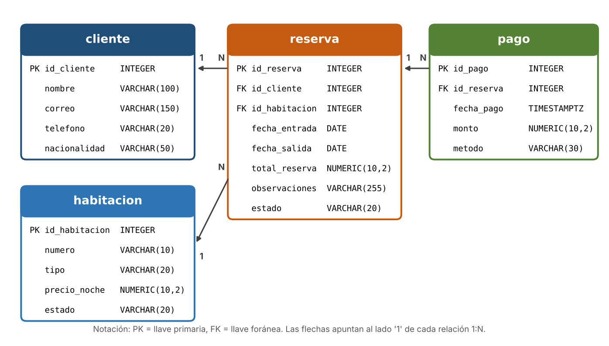

# Proyecto Hotel (PostgreSQL)

Base de datos **HOTEL** para la gestion de clientes, habitaciones, reservas y pagos.
Taller de Bases de Datos, Parte 1: diseno fisico y DDL.

## Modelo



| Tabla | Descripcion |
|---|---|
| `cliente` | Huespedes del hotel |
| `habitacion` | Inventario fisico de habitaciones |
| `reserva` | Vinculo cliente-habitacion en un rango de fechas |
| `pago` | Pagos asociados a una reserva |

## Estructura del repositorio

```
Proyecto_Hotel/
├── sql/
│   ├── 01_schema.sql    extension, CREATE TABLE e indices
│   ├── 02_seed.sql      datos de ejemplo
│   ├── 03_alter.sql     ALTER TABLE (observaciones, estado, nueva exclusion)
│   └── 04_pruebas.sql   pruebas de integridad, DROP y TRUNCATE de ejemplo
├── docs/
│   └── diagrama_er.png
└── README.md
```

## Requisitos

- PostgreSQL (probado en la version 18)
- Extension `btree_gist` (el script `01_schema.sql` la crea)

## Orden de ejecucion

1. `sql/01_schema.sql`
2. `sql/02_seed.sql`
3. `sql/03_alter.sql`
4. `sql/04_pruebas.sql` (algunas sentencias fallan a proposito; ver los comentarios "Esperado")

> `01_schema.sql` empieza con `DROP TABLE IF EXISTS ... CASCADE`: borra las tablas
> existentes. Usar solo en entornos de taller o pruebas.

## Convenciones

- Nombres en `snake_case`.
- Restricciones con prefijo: `pk_`, `fk_`, `uq_`, `chk_`, `ex_`, `idx_`.
